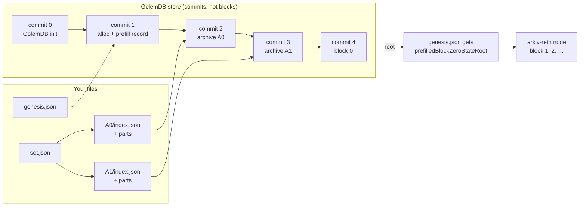
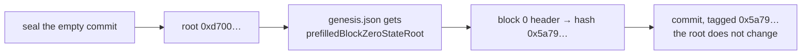

# Prefill, by example

A prefilled chain starts with data already in block 0: entities read from archive files, not created by transactions. This page walks through one small prefill end to end, the committed fixture in [`crates/arkiv-prefill/fixtures/small`](../crates/arkiv-prefill/fixtures/small), and stops at every place where it is easy to go wrong.

- The operator steps, in order, with every refusal the node can give: [prefill-runbook.md](prefill-runbook.md).
- The archive format as a reference: the [`arkiv-prefill` crate docs](../crates/arkiv-prefill/src/lib.rs).
- The genesis field the prefill writes: [genesis-spec.md, section 7](genesis-spec.md).

Every output and error message below was produced by `arkiv-reth prefill` on the fixture or on a copy of it with one thing broken.

## The picture



Three commands do all of it:

```bash
arkiv-reth prefill --chain genesis.json --archives set.json --store "$PWD/golemdb"              # archives → commits
arkiv-reth prefill --chain genesis.json --archives set.json --store "$PWD/golemdb" --finalize   # block 0 → root into genesis.json
ARKIV_STORE_PATH="$PWD/golemdb" arkiv-reth node --chain genesis.json                              # the chain
```

No blocks are produced before block 0, so no block time or gas limit applies: speed depends on the disk. Every entity still goes through the same executor as a transaction, at block 0, so data a transaction could not write is refused.

## 1. The files

```text
small/
├── genesis.json            the chain: a normal Arkiv genesis file, without the field
├── set.json                which archives, in which order
├── A0/
│   ├── index.json          which parts make up archive A0, in order
│   └── entities-0001.jsonl one entity per line
└── A1/
    ├── index.json
    ├── entities-0001.jsonl
    └── entities-0002.jsonl
```

```jsonc
// set.json
{"version": 1, "archives": ["A0/index.json", "A1/index.json"]}
```

```jsonc
// A1/index.json
{"version": 1, "parts": ["entities-0001.jsonl", "entities-0002.jsonl"]}
```

One archive is one GolemDB commit. Paths are relative to the file that names them and must stay inside its directory, so a whole prefill is one directory you can copy or publish as it is.

> [!WARNING]
> **The order in `set.json` is the commit order, and it is part of block 0.** The same archives in another order give another root. Reordering after a prefill started is refused:
> `commit 3 holds an archive hashing to 0x187c…, but archive 2 of the list, A0/index.json, hashes to 0xd4d2…: the list changed since …`

> [!WARNING]
> **Size archives for memory, not for neatness.** The prefill holds one archive's writes in memory until it commits it. Keep each archive to at most a few hundred megabytes; split a big dataset into more archives, not bigger ones. Parts are only for your convenience: an archive is read part by part, line by line, in index order.

## 2. One entity, one line

A part is JSON Lines. Here is the first line of `A0/entities-0001.jsonl`, spread out:

```jsonc
{
  "$key":         "0xa1a1…a1",            // the entity key, 32 bytes hex. You choose it.
  "$creator":     "0x1111…1111",          // who created it, 20 bytes hex
  "$owner":       "0x1111…1111",          // who owns it; another address here = created, then transferred
  "$expiresAt":   1500000,                // the block it expires at: a decimal number or decimal string
  "$contentType": "text/plain",           // optional
  "$payload":     "aGVsbG8sIGJsb2NrIDA=", // optional, base64
  "kind":         "str:note",             // an indexed attribute: "<tag>:<value>"
  "size":         "i32:14"
}
```

Fields starting with `$` are system fields; every other field is an indexed attribute, written as a tagged string:

| Tag | Example | |
|---|---|---|
| `str` | `"str:note"` | |
| `i32` | `"i32:-3"` | decimal |
| `u64` | `"u64:0xffffffff"` | decimal or `0x` hex |
| `bool` | `"bool:true"` | |
| `addr` | `"addr:0x2222…2222"` | 20 bytes |
| `key` | `"key:0xa1a1…a1"` | an entity key, e.g. a parent |
| `bytes32` | `"bytes32:0x4242…42"` | 32 bytes |

`$creationFlags` takes `["readonly"]` and/or `["permissionlessExtension"]`, as `0xa3…` and `0xb2…` in the fixture do.

> [!CAUTION]
> **Gotchas in a line, and what the prefill says:**
>
> | You wrote | It says |
> |---|---|
> | `"kind": "note"` | `"kind" is not a tagged string: "note"` |
> | `"size": 3` | `"size" is not a tagged string: 3`: numbers are tagged strings too, `"i32:3"` |
> | `"$expiresAt": 0` | `"$expiresAt" is 0: the entity would already be expired at block 0` |
> | `"$expiresAt": "0x64"` | `"$expiresAt" is not a number: "0x64"`: decimal only, unlike `u64:` attributes |
> | `"$key": "0x1234"` | `"$key" is not an entity key: "0x1234"`: a full 32 bytes |
> | `"$payload": "hello!"` | `"$payload" is not base64: …` |
> | `"$foo": "x"` | `unknown field "$foo"`: `$` names are reserved, no custom ones |
> | a 33-byte attribute name | `attribute names are at most 32 bytes` |
> | the same `$key` twice, in one archive or two | `A1/p.jsonl:1: refused: AlreadyExists { key: [194, 194, …] }`: the key is printed as decimal bytes |
> | `$key` 0x00…00, or `keccak256("arkiv.prefill")` | also `AlreadyExists`: both are taken by the chain's own records |
> | a `str:` value longer than the genesis file's `max_str_len` (128 in the fixture) | `the executor failed: Store("Entity(Store(InvalidArgument))")`: not a helpful message; check value lengths against `config.arkiv.golemdb.cell_limits` before you start |
> | a line over 1 MiB | `line longer than 1048576 bytes; is the part missing its line breaks?` |
>
> Every error names the file and line (`A0/p.jsonl:2: …`), and nothing of a refused archive is committed: fix the line and run again.

Things that are **not** errors, but may surprise you:

- **`$expiresAt` is kept as given.** `max_lifetime` limits transactions, not prefilled data: `0xb1…` expires at block 1,000,000,000.
- **Prefilled entities are not purged at their expiry yet.** That waits for the new pruning design (#333, deferred). Pick expiries as if they will be, because they will.
- **Creating is free.** No fee is charged and nothing goes to the storage pool, so creators don't need a balance or an `alloc` entry. Everything after block 0 costs the normal price.
- **A key without `0x` is accepted**, and so are attribute names like `Kind` or `my-kind`. Pick one spelling per name and keep to it.
- **Keys are taken as given, not derived.** A transaction's create derives its key from the creator and a nonce; a prefill line names its key. If you import from another chain, keep its keys. Each prefilled create still advances its creator's creation nonce, as a transaction would, so the creator's first transaction after block 0 continues from there.

## 3. The genesis file

A normal Arkiv genesis file ([genesis-spec.md](genesis-spec.md)), without `config.arkiv.prefilledBlockZeroStateRoot`. Its `config.arkiv.golemdb` limits are the limits every line is checked against, and its `alloc` is written into commit 1, before the archives.

> [!WARNING]
> **Settle the genesis file before the first run.** The prefill records a hash of it. Any change afterwards, even the chain id, is refused at a resume and at node start:
> `the genesis file changed since this prefill started: it hashes to 0x7f7d…, but the prefill started with one hashing to 0x23f4…`
>
> Write a `terminalTotalDifficulty` above 2^64 as a hex string, as the runbook says.

## 4. Run it

```bash
arkiv-reth prefill --chain genesis.json --archives set.json --store "$PWD/golemdb"
```

```text
chain 424242: 2 archives in set.json
store: empty; writing the genesis accounts, then the archives
A0/index.json  committed as commit 2 · 3 entities · 0.1 s · 0xd4d2a083…2e34
A1/index.json  committed as commit 3 · 3 entities · 0.0 s · 0x187c4045…fd9d
2 of 2 archives in. Run again with --finalize to commit block 0.
```

The hash after each archive is the archive's hash: keccak256 of its index file and parts, byte for byte. It tags the archive's commit so a resumed run knows what is done.

> [!WARNING]
> **`--store` must be an absolute path** (or start with `~`): `--store golemdb` gives `the GolemDB directory must be an absolute path, such as ARKIV_STORE_PATH=/var/lib/arkiv/golemdb or ~/arkiv/golemdb`. The same holds for the node's `ARKIV_STORE_PATH`.

**Stopped part way?** Run the same command again. It continues after the last committed archive, once it has checked the genesis file, the number of archives and the last committed archive's hash. A bad line stops it like this, with A0 already in:

```text
A0/index.json  committed as commit 2 · 3 entities · 0.1 s · 0xd4d2…
Error: A1/entities-0002.jsonl:2: not a JSON object: expected ident at line 1 column 2
```

Fix `A1` (it is not committed yet) and run again: only A1 is written.

> [!CAUTION]
> **Never touch an archive once it is committed, not even its whitespace.** Its hash is over the raw bytes, so a reformatted file is a different archive. But only the *last* committed archive is checked on a resume, so an edit to an earlier one goes unnoticed: the run carries on, and your store no longer matches the files you publish. The audit (step 6) is what catches it, by rebuilding block 0 from the published files. To change committed data, start again in an empty directory.

## 5. Finalize, and get block 0's hash

```bash
arkiv-reth prefill --chain genesis.json --archives set.json --store "$PWD/golemdb" --finalize
```

```text
chain 424242: 2 archives in set.json
block 0 committed as commit 4: state root 0xd700bb5e793997aa20a009ec5924ddd02ad769da92b481ee4e02c08edc4d484c, hash 0x5a79e960d4250df03decfdea1764d27c2833cf6e5a464331d7c01ad5325faaae
wrote config.arkiv.prefilledBlockZeroStateRoot = 0xd700bb5e…484c into genesis.json
Start the chain with: arkiv-reth node --chain genesis.json
```

Block 0 can't take its root from `alloc` the way a normal genesis does, because the data is in the archives. So finalizing commits one more, empty commit, reads GolemDB's root, and writes it into the genesis file. Block 0's header carries that root, and its hash tags the commit. This works although the tag depends on the root, because tags sit outside the root:



**Where to get block 0's hash:**

| From | How |
|---|---|
| The finalize | the `hash 0x…` on its first line, above |
| A finalized store, later | run `--finalize` again: `the store's prefill is already finalized: block 0's root is 0xd700…, its hash 0x5a79…` |
| A running node | `cast block 0 --field hash --rpc-url http://localhost:8545` |
| The published files | the audit, step 6: it rebuilds block 0 and prints the same line |

The genesis file holds the root, not the hash. The hash also covers the rest of the header (timestamp, gas limit, extra data and so on), which the node builds from the same file.

> [!WARNING]
> **One finalize per store.** A second `--finalize` is refused and leaves the genesis file alone.
>
> **If the genesis file could not be written** (read-only, full disk, a crash between the commit and the write), don't prefill again. The error names the root (`block 0 is committed, but writing genesis.json failed: … Add "prefilledBlockZeroStateRoot": "0xd700…" under config.arkiv by hand`). Add it by hand; the node checks it against the store at start.

> [!IMPORTANT]
> **Copy the store now, before any node runs on it:** `cp -R golemdb golemdb-block0`. That copy is what you publish for joining nodes: it is exactly block 0, which anyone can check against the genesis file. A store a node has run on is already past block 0.

## 6. Audit: anyone can rebuild block 0

Give someone the finalized `genesis.json`, `set.json` and the archives. Into an empty store, on any machine:

```bash
arkiv-reth prefill --chain genesis.json --archives set.json --store /tmp/audit
arkiv-reth prefill --chain genesis.json --archives set.json --store /tmp/audit --finalize
```

```text
block 0 committed as commit 4: state root 0xd700…484c, hash 0x5a79…aaae
it matches genesis.json's prefilledBlockZeroStateRoot
```

With the field already in the genesis file, `--finalize` doesn't write it: it compares, and refuses a different root (`these archives don't produce this chain's block 0: their root is …, but the genesis file's prefilledBlockZeroStateRoot is …`). The prefill hash leaves the field out, so the finalized file and the original one are the same genesis to the prefill.

For the fixture, `just prefill_check` does exactly this in CI and compares with [`expected.json`](../crates/arkiv-prefill/fixtures/small/expected.json).

## 7. Start and join

```bash
ARKIV_STORE_PATH=/var/lib/arkiv/golemdb arkiv-reth node --chain genesis.json …
```

The node takes block 0 from the field, checks the store's block 0 has that root, and produces block 1 onwards as usual. `arkiv_getEntity` on `0xa1…` gives `createdAt: 0x0`.

A joining node starts from a copy of the block 0 store (`golemdb-block0`) with the same genesis file, and syncs blocks 1 onwards from its peers. A later store of the same chain also works, since the joiner skips the blocks its store already holds, but copy one only from a stopped node.

> [!WARNING]
> **The genesis file and the store must come from the same prefill.** The node checks this before anything else, and each mismatch has its own refusal: an empty store, an unfinished or unfinalized prefill, a genesis file edited after the prefill or from before `--finalize`, a store finalized from other archives, another chain's store. The full table, with what to do for each, is in the [runbook](prefill-runbook.md#when-the-node-refuses-to-start).

## Gotchas at a glance

| Symptom | Cause | Fix |
|---|---|---|
| `is not a tagged string` | attribute without `<tag>:` | `"str:…"`, `"i32:…"`, … |
| `"$expiresAt" is 0` / `is not a number` | expiry 0, or hex | a decimal block number above 0 |
| `refused: AlreadyExists { key: [ … ] }` | a key given twice, or the zero or prefill record key | unique keys; decode the bytes to find it |
| `Store("Entity(Store(InvalidArgument))")` | a value over a `cell_limits` size | check lengths against the genesis file's limits |
| `must be an absolute path` | relative `--store` | `"$PWD/golemdb"` |
| `the list changed since this prefill started` | archives reordered, or the last committed one edited | restore the files, or start over in an empty store |
| `this store was started with 2 archives; 1 were given` | archives added to or removed from `set.json` | the set the prefill started with |
| `the genesis file changed since this prefill started` | genesis edited after the first run | the original file, or start over |
| the audit's root differs | an earlier committed archive edited after it was committed | publish exactly the committed files |
| prefilled entities outlive their expiry | expiry purging is deferred (#333) | expected for now |
