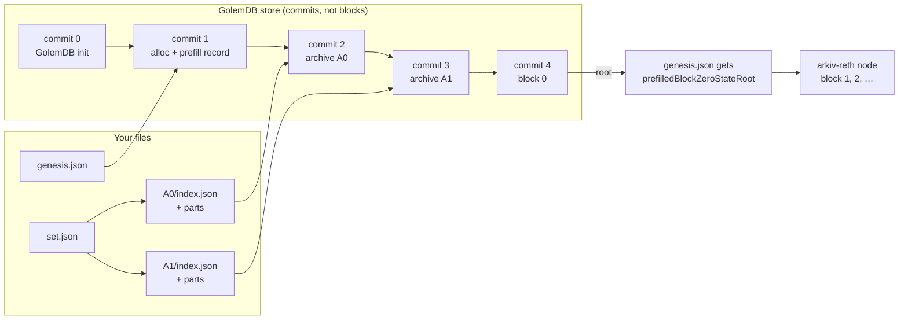
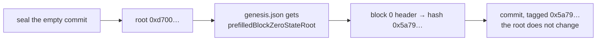

# Prefill, by example

A prefilled chain is a chain whose block 0 already contains data. The entities in it are read from archive files instead of being created by transactions. This page walks through one small prefill from start to finish, using the fixture committed in [`crates/arkiv-prefill/fixtures/small`](../crates/arkiv-prefill/fixtures/small). Along the way it points out the places where people most often go wrong.

If you need something more specific, these pages go further:

- [prefill-runbook.md](prefill-runbook.md) lists the operator steps in order, with every error the node can give at start-up and what to do about each one.
- The [`arkiv-prefill` crate docs](../crates/arkiv-prefill/src/lib.rs) are the full reference for the archive format.
- [Section 7 of genesis-spec.md](genesis-spec.md) describes the genesis field that the prefill writes.

All of the output and error messages on this page are real. They come from running `arkiv-reth prefill` on the fixture, or on a copy of it with one thing deliberately broken.

## The big picture

You start with a genesis file, a set file and some archives. The prefill turns each archive into one GolemDB commit. Finalizing adds one more commit, which becomes block 0, and writes that commit's state root into the genesis file. From then on the chain runs normally from block 1.



The whole process takes three commands. The first writes the archives, the second finalizes block 0, and the third starts the chain.

```bash
arkiv-reth prefill --chain genesis.json --archives set.json --store "$PWD/golemdb"
arkiv-reth prefill --chain genesis.json --archives set.json --store "$PWD/golemdb" --finalize
ARKIV_STORE_PATH="$PWD/golemdb" arkiv-reth node --chain genesis.json
```

Because no blocks are produced before block 0, there is no block time or gas limit to slow the prefill down. How fast it runs depends only on your disk. Even so, every entity goes through the same executor that handles transactions, as if it were created at block 0. Anything a transaction would not be allowed to write is refused here as well.

## 1. The files

The fixture is laid out like this:

```text
small/
├── genesis.json            a normal Arkiv genesis file, without the prefill field
├── set.json                the list of archives, in order
├── A0/
│   ├── index.json          the list of parts that make up archive A0, in order
│   └── entities-0001.jsonl one entity per line
└── A1/
    ├── index.json
    ├── entities-0001.jsonl
    └── entities-0002.jsonl
```

The set file lists the archives:

```json
{"version": 1, "archives": ["A0/index.json", "A1/index.json"]}
```

Each archive's index file lists its parts. This is `A1/index.json`:

```json
{"version": 1, "parts": ["entities-0001.jsonl", "entities-0002.jsonl"]}
```

Every path is relative to the file that contains it, and it has to stay inside that file's directory. This means a whole prefill lives in a single directory, which you can copy or publish as it is.

Each archive becomes exactly one GolemDB commit. Parts exist only for your convenience. The prefill reads an archive one part at a time, in the order the index gives, and each part one line at a time.

> [!WARNING]
> **The order of the archives in `set.json` is part of block 0.** It is the order in which they are committed, so the same archives in a different order produce a different state root. If you reorder them after the prefill has started, the next run refuses to continue:
>
> `commit 3 holds an archive hashing to 0x187c…, but archive 2 of the list, A0/index.json, hashes to 0xd4d2…: the list changed since …`

> [!WARNING]
> **Choose archive sizes with memory in mind.** The prefill keeps all of an archive's writes in memory until it commits that archive. Keep each archive to a few hundred megabytes at most. If your dataset is large, split it into more archives rather than making them bigger.

## 2. Writing an entity

A part is a JSON Lines file, which means it holds one JSON object per line. Each line describes one entity. Here is the first line of `A0/entities-0001.jsonl`, spread over several lines so the comments fit:

```jsonc
{
  "$key":         "0xa1a1…a1",            // the entity key (32 bytes, hex), which you choose
  "$creator":     "0x1111…1111",          // the account that created it (20 bytes, hex)
  "$owner":       "0x1111…1111",          // the account that owns it
  "$expiresAt":   1500000,                // the block at which it expires
  "$contentType": "text/plain",           // optional
  "$payload":     "aGVsbG8sIGJsb2NrIDA=", // optional, base64-encoded
  "kind":         "str:note",             // an indexed attribute
  "size":         "i32:14"                // another indexed attribute
}
```

Fields whose names start with `$` are system fields. If `$owner` is different from `$creator`, the entity is created by the creator and then transferred to the owner. `$expiresAt` can be a number or a string, but either way it must be written in decimal.

Every field without a `$` is an indexed attribute. Its value is always a string made of a type tag, a colon, and the value itself. These are the tags:

| Tag | Example | What the value is |
|---|---|---|
| `str` | `"str:note"` | any text |
| `i32` | `"i32:-3"` | a signed 32-bit number, in decimal |
| `u64` | `"u64:0xffffffff"` | an unsigned 64-bit number, in decimal or `0x` hex |
| `bool` | `"bool:true"` | `true` or `false` |
| `addr` | `"addr:0x2222…2222"` | a 20-byte address |
| `key` | `"key:0xa1a1…a1"` | another entity's key, for example a parent |
| `bytes32` | `"bytes32:0x4242…42"` | any 32 bytes |

An entity can also carry `$creationFlags`, which is a list holding `"readonly"`, `"permissionlessExtension"`, or both. In the fixture, `0xa3…` is read-only and `0xb2…` allows anyone to extend it.

### Mistakes in a line

When a line is wrong, the prefill stops and names the file and line number, for example `A0/p.jsonl:2`. Nothing from the archive with the bad line is committed, so you can fix the line and run the same command again. These are the mistakes people make most often, with the message each one produces:

| What was written | What the prefill says | What it means |
|---|---|---|
| `"kind": "note"` | `"kind" is not a tagged string: "note"` | The attribute is missing its type tag. Write `"str:note"`. |
| `"size": 3` | `"size" is not a tagged string: 3` | Numbers need a tag as well. Write `"i32:3"`. |
| `"$expiresAt": 0` | `"$expiresAt" is 0: the entity would already be expired at block 0` | The expiry has to be a block after block 0. |
| `"$expiresAt": "0x64"` | `"$expiresAt" is not a number: "0x64"` | The expiry must be decimal, even though `u64:` attributes accept hex. |
| `"$key": "0x1234"` | `"$key" is not an entity key: "0x1234"` | A key must be a full 32 bytes. |
| `"$payload": "hello!"` | `"$payload" is not base64: …` | The payload has to be base64-encoded. |
| `"$foo": "x"` | `unknown field "$foo"` | Names starting with `$` are reserved, so you cannot add your own. |
| an attribute name 33 bytes long | `attribute names are at most 32 bytes` | Shorten the name. |
| the same `$key` used twice | `refused: AlreadyExists { key: [194, 194, …] }` | Each key can be used only once, across all archives. Note that the message prints the key as a list of decimal byte values rather than as hex. |
| the key `0x00…00`, or `keccak256("arkiv.prefill")` | `refused: AlreadyExists { … }` | Both keys are already used by the chain's own records. |
| a `str:` value longer than the genesis file allows | `the executor failed: Store("Entity(Store(InvalidArgument))")` | This message does not say which limit was hit. The limits are in the genesis file under `config.arkiv.golemdb.cell_limits` (the fixture allows strings of up to 128 bytes), so check your values against them before you start. |
| a line longer than 1 MiB | `line longer than 1048576 bytes; is the part missing its line breaks?` | Usually this means the file lost its line breaks. |

### Things that are allowed but may surprise you

- **Expiries are kept exactly as you write them.** The chain's `max_lifetime` setting limits transactions, but it does not apply to prefilled data. In the fixture, `0xb1…` expires at block 1,000,000,000.
- **Prefilled entities are not yet removed when they expire.** That will come with the new pruning design, which is tracked in #333. Choose your expiries as if they were already enforced, because they will be.
- **Creating prefilled entities is free.** No fee is charged and nothing is paid into the storage pool, so the creators do not need a balance or an entry in `alloc`. Everything after block 0 costs the normal price.
- **The prefill accepts a key written without `0x`**, and attribute names such as `Kind` or `my-kind`. Whatever spelling you choose for a name, use the same one everywhere.
- **Keys are used as written.** When a transaction creates an entity, the key is derived from the creator and a counter. A prefill line simply states its key. If you are importing data from another chain, keep the keys it already has. Each prefilled entity still moves its creator's counter forward, just as a transaction would, so that creator's first transaction after block 0 carries on from where the prefill left off.

## 3. The genesis file

The genesis file is a normal Arkiv genesis file, as described in [genesis-spec.md](genesis-spec.md). It must not contain `config.arkiv.prefilledBlockZeroStateRoot` yet, because the prefill adds that field when it finalizes. Two parts of the file matter to the prefill. The limits under `config.arkiv.golemdb` are the limits every entity line is checked against, and the accounts in `alloc` are written in commit 1, before any archive.

> [!WARNING]
> **Finish editing the genesis file before you start the prefill.** On its first run, the prefill records a hash of the file. If you change anything afterwards, even only the chain id, a resumed prefill refuses to continue and the node refuses to start:
>
> `the genesis file changed since this prefill started: it hashes to 0x7f7d…, but the prefill started with one hashing to 0x23f4…`
>
> If your `terminalTotalDifficulty` is larger than 2^64, write it as a hex string, as the runbook explains.

## 4. Running the prefill

Run the first command:

```bash
arkiv-reth prefill --chain genesis.json --archives set.json --store "$PWD/golemdb"
```

On the fixture, it prints:

```text
chain 424242: 2 archives in set.json
store: empty; writing the genesis accounts, then the archives
A0/index.json  committed as commit 2 · 3 entities · 0.1 s · 0xd4d2a083…2e34
A1/index.json  committed as commit 3 · 3 entities · 0.0 s · 0x187c4045…fd9d
2 of 2 archives in. Run again with --finalize to commit block 0.
```

The hash at the end of each archive's line is that archive's hash. It is computed from the exact bytes of the index file and the parts. The prefill stores it with the commit, which is how a later run knows which archives are already done.

> [!WARNING]
> **The store path must be absolute.** It can also start with `~`. If you pass a relative path such as `--store golemdb`, the prefill stops with `the GolemDB directory must be an absolute path, such as ARKIV_STORE_PATH=/var/lib/arkiv/golemdb or ~/arkiv/golemdb`. The same rule applies to `ARKIV_STORE_PATH` when you start the node.

### Resuming after a stop

If the prefill stops part of the way through, because of a crash, a Ctrl-C or a bad line, run the same command again. Before it continues, it checks that the genesis file, the number of archives and the hash of the last committed archive are all unchanged. It then picks up after the last archive it committed.

For example, here is a run that stopped on a bad line in the second archive, after the first archive was already committed:

```text
A0/index.json  committed as commit 2 · 3 entities · 0.1 s · 0xd4d2…
Error: A1/entities-0002.jsonl:2: not a JSON object: expected ident at line 1 column 2
```

Archive A1 was not committed, so you can fix it. When you run the command again, the prefill writes only A1.

> [!CAUTION]
> **Once an archive is committed, do not change it, not even its whitespace.** An archive's hash covers its raw bytes, so even reformatting a file turns it into a different archive. A resumed run only checks the most recently committed archive, so a change to an earlier one goes unnoticed. The prefill carries on, but your store no longer matches the files you are going to publish. The audit in step 6 catches this, because it rebuilds block 0 from the published files. If you need to change data that is already committed, start again with an empty store directory.

## 5. Finalizing and getting block 0's hash

Once every archive is in, finalize:

```bash
arkiv-reth prefill --chain genesis.json --archives set.json --store "$PWD/golemdb" --finalize
```

On the fixture, it prints:

```text
chain 424242: 2 archives in set.json
block 0 committed as commit 4: state root 0xd700bb5e793997aa20a009ec5924ddd02ad769da92b481ee4e02c08edc4d484c, hash 0x5a79e960d4250df03decfdea1764d27c2833cf6e5a464331d7c01ad5325faaae
wrote config.arkiv.prefilledBlockZeroStateRoot = 0xd700bb5e…484c into genesis.json
Start the chain with: arkiv-reth node --chain genesis.json
```

A normal chain computes block 0's state root from the accounts in `alloc`. A prefilled chain cannot do that, because most of its data is in the archives. So finalizing adds one more, empty commit, reads GolemDB's state root, and writes that root into the genesis file. Block 0's header is then built from the genesis file, including that root, and block 0's hash is attached to the commit as its tag.

This may look circular, since the tag depends on the root. It works because tags are stored outside the data the root covers, so adding the tag does not change the root.



### Where to find block 0's hash

The genesis file contains the state root, not the hash. The hash also covers the rest of block 0's header, such as the timestamp, the gas limit and the extra data. You can find it in four places:

| Where | How |
|---|---|
| The finalize output | It is the `hash 0x…` on the first line of output, shown above. |
| A store that is already finalized | Run `--finalize` again. It refuses, and its message gives both values: `the store's prefill is already finalized: block 0's root is 0xd700…, its hash 0x5a79…`. |
| A running node | Run `cast block 0 --field hash --rpc-url http://localhost:8545`. |
| The published files | Run the audit in step 6, which rebuilds block 0 and prints the same line as the finalize. |

> [!WARNING]
> **A store can be finalized only once.** A second `--finalize` is refused, and it leaves the genesis file as it is.
>
> **If the genesis file could not be written,** for example because it is read-only, the disk is full, or the machine crashed between the commit and the write, do not run the prefill again. The error message gives you the root: `block 0 is committed, but writing genesis.json failed: … Add "prefilledBlockZeroStateRoot": "0xd700…" under config.arkiv by hand`. Add the field yourself. If you mistype it, the node notices when it starts, because it checks the root against the store.

> [!IMPORTANT]
> **Copy the store now, before any node runs on it.** Run `cp -R golemdb golemdb-block0`. This copy is what you publish for nodes that want to join. It holds exactly block 0, so anyone can check it against the genesis file. A store that a node has already run on has moved past block 0.

## 6. Auditing: anyone can rebuild block 0

Anyone who has the finalized `genesis.json`, the set file and the archives can check the result. On any machine, and into an empty store, they run:

```bash
arkiv-reth prefill --chain genesis.json --archives set.json --store /tmp/audit
arkiv-reth prefill --chain genesis.json --archives set.json --store /tmp/audit --finalize
```

```text
block 0 committed as commit 4: state root 0xd700…484c, hash 0x5a79…aaae
it matches genesis.json's prefilledBlockZeroStateRoot
```

Because the genesis file already contains the field, `--finalize` does not write anything to it. Instead, it compares the root it computes with the one in the file. If they differ, it refuses with `these archives don't produce this chain's block 0: their root is …, but the genesis file's prefilledBlockZeroStateRoot is …`.

The audit can use the finalized genesis file because the hash the prefill records leaves the field out. To the prefill, the finalized file and the original file are the same.

For the fixture, CI runs this check with `just prefill_check`, and compares the result with [`expected.json`](../crates/arkiv-prefill/fixtures/small/expected.json).

## 7. Starting the chain and joining it

Start the node with the store and the finalized genesis file:

```bash
ARKIV_STORE_PATH=/var/lib/arkiv/golemdb arkiv-reth node --chain genesis.json …
```

The node reads block 0's root from the genesis file and checks that the store's block 0 has the same root. It then produces blocks from block 1 onwards as usual. If you ask it for `0xa1…` with `arkiv_getEntity`, it reports `createdAt: 0x0`.

A node that wants to join the chain starts from a copy of the block 0 store, `golemdb-block0`, with the same genesis file. It then syncs block 1 onwards from its peers. A later copy of the store also works, because the joining node skips the blocks its store already holds. If you use a later copy, take it from a node that is stopped, since copying the directory of a running node can catch it in the middle of a write.

> [!WARNING]
> **The genesis file and the store must come from the same prefill.** The node checks this before it does anything else, and each kind of mismatch has its own error message. This covers an empty store, a prefill that is unfinished or not finalized, a genesis file that was edited after the prefill or that dates from before `--finalize`, a store finalized from different archives, and a store from another chain. The [runbook](prefill-runbook.md#when-the-node-refuses-to-start) lists every message and what to do about each one.

## Summary of the gotchas

| What you see | Why it happens | What to do |
|---|---|---|
| `is not a tagged string` | An attribute value has no type tag. | Add the tag, for example `"str:…"` or `"i32:…"`. |
| `"$expiresAt" is 0` or `is not a number` | The expiry is 0, or it is written in hex. | Write a decimal block number greater than 0. |
| `refused: AlreadyExists { key: [ … ] }` | A key is used twice, or it is one of the two reserved keys. | Make every key unique. Convert the printed bytes to hex to find the duplicate. |
| `Store("Entity(Store(InvalidArgument))")` | A value is larger than a limit in `cell_limits`. | Check your values against the limits in the genesis file. |
| `must be an absolute path` | The store path is relative. | Use an absolute path, such as `"$PWD/golemdb"`. |
| `the list changed since this prefill started` | The archives were reordered, or the last committed archive was edited. | Put the files back as they were, or start again with an empty store. |
| `this store was started with 2 archives; 1 were given` | Archives were added to or removed from `set.json`. | Use the set file the prefill started with. |
| `the genesis file changed since this prefill started` | The genesis file was edited after the first run. | Use the original file, or start again. |
| The audit reports a different root. | An earlier archive was edited after it was committed. | Publish exactly the files that were committed. |
| Prefilled entities are still there after their expiry. | Removing expired prefilled entities is not built yet (#333). | Nothing for now. This is expected. |
