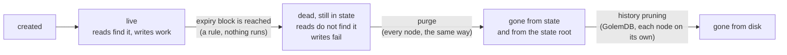
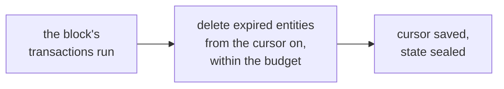

# Purging expired entities

Status: draft for review. Tracked in [#379] and [#380].

## Summary

Every entity has an expiry block. From that block on the entity is dead: no read returns it and no
write can change it. That rule is in place today. What is missing is a sound way to take the dead
entity out of the chain's state, which we call the purge. Today the block producer decides what to
purge, up to ten entities per block, and nothing makes it purge at all.

We propose that every node purges at the end of each block, after the block's transactions. Dead
entities are removed oldest expiry first, as selected from the state the previous block committed,
and a cursor in the state records how far the purge has got. The purge's budget is 20% of the gas
limit plus whatever compute gas the block's transactions left unused. When more entities are due
than fit, the rest wait for the next block, and they stay invisible while they wait. Nothing about
the purge appears in the block.

Most of this comes from the design tracked in [#292]. The difference is the budget, and with it the
purge's place in the block. A fixed 20% before the transactions, as in #292's spec, falls behind
when most of the gas goes to creating entities. A fixed 60% keeps up, but lets a block do 1.6 times
the work of a full one, which for the same hardware means a gas limit a quarter lower. A budget that
grows with the gas the transactions leave unused keeps up while no block does more than 1.2 times
the work of a full one, and it is known only once they have run. The Cosmos SDK, Substrate and
Ethereum also clear expired or queued items at the end of the block.

The argument rests on measurements on GolemDB, a model, a randomized check of the rule, a month of
rabdi's logs, and the experience of those systems. The proposed rule has not run on an Arkiv node
yet.

## Background

An entity is created with an expiry block. An extension can move that block later, never earlier.
The chain treats the entity as expired from that block on, whether or not its bytes are still
stored. The [stage plan] froze this contract together with the SDK: expired entities "are invisible
to every query and reject every op from the expiry block on", and "there is no expiry or purge
event".

So an entity passes through three moments, and this document is about the second.



Removing an entity changes the state root, so it is part of consensus: every node has to remove the
same entities in the same block.

A few words and sources recur. GolemDB, Arkiv's storage engine, measures its work in cost units, and
on Arkiv one cost unit is charged as one gas. A transaction's gas has two parts that matter here.
Compute gas pays for the work done in the block: the transaction itself, its operations and
GolemDB's work. Storage gas pays for holding bytes over the entity's lifetime and causes no work.
The fee target is half the gas limit; the base fee rises when blocks are fuller than that. The
removal ratio of an entity is the cost of removing it divided by the gas its creation used. Prices
come from the genesis file; the figures here use those of rabdi, Arkiv's current test network.

Four documents are cited throughout. [#292]'s spec is [`docs/purging-spec.md`][purging spec] on the
branch `matthiaszimmermann/feat/tokenomics-init`, and the tokenomics spec is
`docs/tokenomics-spec.md` on the same branch. GolemDB's tokenomics draft is
`docs/arkiv-tokenomics.md` in the GolemDB repository, the earlier draft those two build on.
Tokenomics v1 is `docs/tokenomics_v1.md` in this repository, what the node does today.

## The current mechanism

The node has purged expired entities since September 2026 ([#86], [#93]). The block producer keeps a
private database of expiries, `arkiv-pruning.db`, built from transaction logs. At the start of each
block it asks that database for up to ten expired entities and lists their keys in a `purgeExpired`
transaction. The other nodes delete what the list says. They skip an entry that has not expired, but
they do not check that the list is the right one, or that there is a list at all.

This works with one trusted producer and a light load, and has four limits. The purge is optional: a
producer whose database is behind, or slower than 100 ms, purges nothing, and the block is still
valid. Entities loaded at genesis never appear in a transaction log, so they are never purged
([#333]). Ten entities per block cannot keep up with the 250 small entities that fit into one block
([tokenomics v1]); on rabdi, after a burst of writes on 3 November 2026, the producer took about an
hour and a half to work through the entities that expired from it. And it shows: every block carries
a purge transaction with a receipt, although the stage plan says the purge is not observable.

## What the design must guarantee

We wrote these down before choosing a design, and judged every candidate against them. `N` is the
current block, and an entity is dead when its expiry block is `N` or earlier and it is still stored.

After every block:

1. **Not observable.** No read, and no operation's success or failure, depends on how far the purge
   has got.
2. **Never early.** Only dead entities are removed.
3. **One answer.** What a block removes follows from the parent block's state, the block and the
   chain's settings, and from nothing else. A block that removes anything different is invalid.
4. **Whole entities.** An entity is fully present or fully absent.
5. **One order.** Dead entities are removed oldest expiry first, then in creation order, and none is
   passed over.
6. **Bounded work.** The purge's work in a block has a fixed maximum, and so has the block's total.
7. **Users first.** The purge takes no space from the block's transactions and does not move the
   base fee.
8. **No memory outside the state.** A restart, a crash, a change of producer or a node joining from
   a snapshot needs nothing rebuilt.
9. **Never fails a block.** Nothing the purge meets can make a block invalid or stop the chain.

And over time:

10. **Progress.** While any entity is dead, every block removes at least one, or moves the cursor
    past expiry blocks that hold none.
11. **It drains.** Under any load the fee market can sustain, the number of dead entities stays
    bounded.

We first wrote that among designs meeting all eleven we would prefer the simplest. Two designs
turned out to meet all eleven: a fixed budget of 60% spent at the start of the block, and the rule
proposed here. The fixed 60% is the simpler of the two. We propose the other because of a criterion
we had not written down: the heaviest block a design allows, which decides how high the gas limit
can be set on given hardware. We therefore compare designs that meet all eleven by their heaviest
block first and by simplicity second. A reviewer who weighs simplicity higher should prefer the
fixed 60%, and the document says what that choice costs.

The expiry contract does not change: a writer gets the expiry it asked for. Some things are left to
other work. Freeing disk space belongs to GolemDB's history pruning ([golemdb#142]); the purge only
takes entities out of the state. Paying for the purge belongs to [#310]; on `main` nothing is
charged for removal when an entity is created. Re-orgs belong to [#341]; the purge keeps all of its
state in the chain's state, so whatever undoes a block undoes its purge. Erasure is not promised;
the [litepaper] says expiry "does not erase history". Proofs are not designed for, though a purge
that reads only committed state can be proven later. Chains start from genesis, so no running chain
has to be migrated, and the block time is two seconds.

## Design

### Overview

The design adds one value to the chain's state and one step to the end of every block.

The value is a cursor: the oldest expiry block that may still hold entities. Every entity that
expired before the cursor is already gone.

The step runs after the block's transactions, on every node. It looks up the entities that expired
at the cursor and deletes them one by one, in the order they were created. When none are left, the
cursor moves to the next expiry block, and the step carries on until the cursor passes the current
block or the budget is spent. The next block continues from the cursor.

The budget is never less than 20% of the gas limit, the minimum budget. On top of that the step gets
the compute gas the block's transactions left unused.



### An example

Take a gas limit of 30 million, so a minimum budget of 6 million, and a typical entity that costs
85,000 units to remove.

In an ordinary block the transactions use about half the gas limit. The purge then has 6 million
plus the 15 million left unused, enough for about 240 typical entities. A few dozen are due in most
blocks, and they are removed in the block in which they expire.

Now suppose nine hundred entities share expiry block 1000, because an application wrote them over
several days with the same end date. At block 1000 all nine hundred are dead, and no query returns
them. If blocks stay half full, the purge removes about 240 in each of blocks 1000 to 1002 and the
rest in block 1003. If every block from 1000 on is full, the purge has only its minimum budget,
about 70 entities per block, and the last ones go in block 1012. Either way the chain stored dead
entities for a few blocks, and nobody outside a node could tell.

### How much the purge must remove

The backlog of dead entities is a queue: removal work arrives when entities expire, and the purge
serves up to its budget in every block. Such a queue stays bounded exactly when, on average, no more
arrives than is served ([Neely 2010]).

Removal work cannot arrive faster than entities are created, since each is removed once, and
creation is bounded by the fee market. The base fee "targets half the block gas limit and changes by
at most 1/8 per block" ([tokenomics v1]). Under that rule the long-run average of gas used per block
is at most about 1.06 times the target, 53% of the gas limit; on Ethereum it has measured 2.9% and
later 2.0% above the target ([Leonardos et al. 2022]). The excess over the target comes from the
update being multiplicative. A full block followed by an empty one leaves the base fee lower than it
was (1.125 x 0.875 = 0.984), so the fee holds its level with up to about 53 full blocks for every 47
empty ones. A higher average makes the base fee grow without bound, so it cannot last.

Removing an entity costs less than creating it did. At rabdi's prices we measured removal ratios
between 0.17 and 0.97, depending on the entity's shape (see [Measurement](#measurement)). They are
highest for an entity with many small attributes and lowest for one with a large payload, because a
creation pays for its bytes and a deletion does not ([GolemDB metering], section D4). We take the
ratio `r` to be at most 1.

So, on average, per block:

```
removal work that arrives    <=  0.53 x r x gas_limit
```

A fixed budget `b` keeps up when `b >= 0.53 x r x gas_limit`: a fixed 20% while `r <= 0.38`, a fixed
60% while `r <= 1.13`. The proposed budget falls by exactly the gas the transactions use, so its
average depends only on the average use, not on the pattern of full and empty blocks. With use
averaging at most 53% of the gas limit and a minimum share `m`:

```
proposed budget, on average  >=  (m + 0.47) x gas_limit
keeps up when                     m + 0.47  >=  0.53 x r
```

For `r = 1` that needs `m` of 6%. With `m` at 20% the purge keeps up while `r <= 1.26`.

Two cases fall outside this average, and both are acceptable. Entities written at different times
can expire together; such a wave does not change the average, it only delays removal. And during a
run of full blocks entities are created at up to twice the target rate while the purge has only its
minimum budget. Such runs are short: the base fee is 3 times higher after 10 full blocks, 361 times
after 50 and 130,000 times after 100. The backlog they leave drains once they end.

### Why a fixed budget at the start falls short

#292's spec spends a fixed 20% before the transactions. The tokenomics spec on the same branch gives
the sizing: "Purging an entity costs about 0.6× creating it", and 20% "covers a sustained mix in
which up to about 30% of the gas at the EIP-1559 target goes to creates, with a 2× reserve"
([tokenomics spec]). The model agrees. But we do not think Arkiv can assume that mix: its own use
cases, such as queues, heartbeats and short-lived listings, are mostly creates, and anyone may send
nothing else. When blocks are half full of creates, about 115 typical entities are created per block
and 20% removes about 70, so the backlog grows by about 45 every block. And most of the shapes we
measured have a removal ratio above 0.6.

A fixed 60% keeps up, but its heaviest block does 1.6 times the work of a full one. Nodes "are sized
for the user gas limit plus `purge_budget`" ([GolemDB tokenomics draft]), so for the same hardware
the gas limit has to be a quarter lower than with 20%, for good, to cover a load the fee market
makes rare. Ethereum cut back its gas refunds partly because they let a block do "nearly twice the
on-paper gas limit" of work ([EIP-3529]).

The general point is that four things are wanted from a purge budget, and while removal is not
counted in block gas a design can have at most three of them:

1. it keeps up when all of the gas goes to creates;
2. no block does more than 1.2 times the work of a full one;
3. it takes nothing from users, neither block space nor the expiry they asked for;
4. it runs before the block's transactions.

Keeping up needs an average budget of about half the gas limit. A purge that runs first cannot know
how heavy the block will be, so it has to reserve that half in every block, and the heaviest block
becomes at least 1.5 times a full one. To stay at 1.2, the budget has to shrink when the
transactions are heavy, and that is known only after them. The other way out is for users to give
something up: a budget that grows with the backlog while the users' gas limit shrinks, or the cap on
writes per expiry block of [#351]. We keep the first three, and give up the fourth.

The tokenomics draft gives two reasons for running the purge first ([GolemDB tokenomics draft], "Why
the purge comes first"). The first is that the entities expiring in a block are gone before its
transactions run, so an operation on one fails because the record is absent. With the purge at the
end they are still stored while the transactions run, and the expiry rule refuses the operation
instead. That rule is already on every path: queries get `$expiresAt > block` added
(`crates/arkiv-reth-rpc/src/lib.rs`), view calls served by the executor hide an expired entity
"whether or not it has been physically removed yet" (`crates/arkiv-reth-executor/src/lib.rs`), and
patch, extend and transfer revert. Every design relies on it already, since a backlog leaves dead
entities in the state while transactions run. The one path without the check, delete, gets it here.
The second reason is that bytes the purge frees count for creates in the same block, which matters
near the storage ceiling `max_live_bytes`. That ceiling is not built yet; with the purge at the end
the freed bytes count from the next block.

Running last also saves work outside the block. reth replays a block's start-of-block steps before
it traces or simulates one of its transactions, so a purge at the start would be replayed with them.
A purge at the end never is, because no transaction of the block runs after it.

### The minimum budget

For the purge to keep up at a removal ratio of 1, the minimum budget needs to be 6% of the gas
limit. We propose 20%, for three reasons. During a run of full blocks the purge has nothing else,
and 20% still removes about 70 typical entities per block. The minimum budget alone must cover
removing the largest entity plus one lookup, since a full block leaves nothing more. And 20% is the
share #292's spec already reserves, so nodes are sized as that spec expects: the heaviest block is
1.2 times a full one, as there.

### The rule

The cursor is stored as `purge_cursor` in a reserved record in GolemDB, like the record that tracks
prefill (the entities loaded at genesis), so it is under the state root. At genesis it is 1. Genesis
gains two parameters: `purge_min_share`, the minimum budget as a fraction of the gas limit (0.2),
and `purge_read_cost`, what one lookup costs against the budget.

At the end of block `N`, after its last transaction, every node runs:

```
budget = purge_min_share * gas_limit
       + (gas_limit - compute gas used by the block's transactions)
c      = purge_cursor

while c <= N and budget >= purge_read_cost:
    budget -= purge_read_cost
    page = next page of entities whose $expiresAt is c,
           read from the parent block's state, in record-ID order
    for entity in page:
        if entity is no longer in the state: skip it
        cost = delete(entity, limit = budget)
        if the delete did not fit: stop        # c stays where it is
        budget -= cost
    if that was the last page for c:
        c += 1                                 # this expiry block is clear

purge_cursor = c
```

The lookup reads the parent block's state, because GolemDB queries see committed state only, and
that makes the selection the same on every node. It is still right at the end of the block. Every
entity in an expiry block up to `N` was dead throughout block `N`, and no write may change a dead
entity, so the block's transactions cannot have changed what the lookup returns. Whatever they
created or extended expires after `N`. Within one block the pages of an expiry block follow one
another, and in the next block the lookup starts again from the new parent state. The order is
fixed: expiry block first, then record ID, which is creation order.

The purge stops at the first entity that does not fit and never skips one, or the order would depend
on sizes. GolemDB already refuses a delete that exceeds the limit it is given, and writes nothing in
that case. This is why the minimum budget must cover the largest entity the chain allows plus a
lookup, which the node checks when it reads the genesis. With today's limits of 39 stored fields per
entity, 36 of them indexed, #292's spec estimates that removal at about 930,000 units, and we
measured about 300,000. Both are far below 6 million.

The budget counts compute gas, not storage gas, because storage gas causes no work in the block: a
block full of long-lived entities can be full by gas while the node is mostly idle. Each
transaction's gas is already split into these parts (`GasBreakdown` in
`crates/arkiv-interfaces/src/gas.rs`), and in the tokenomics spec a block's `gasUsed` is its compute
gas alone. The minimum budget is a share of the gas limit, so the budget follows the gas limit when
that changes. The purge adds nothing to `gasUsed`, so the base fee sees user demand only.

Nothing travels in the block. A validator runs the same step on its own copy of the state, and if a
producer purged differently, or not at all, the state roots differ and the block is rejected by the
rule that already exists.

An operation on an expired entity fails with `NotFound`, whether or not the entity has been removed.
Today it reverts with `Expired` while the entity is still stored and with `NotFound` afterwards,
which shows how far the purge has got. Once an entity is removed, a node cannot tell it from one
that never existed, so `NotFound` is the only answer that can be the same before and after; #292's
spec asks for the same. A delete of an expired entity is refused like any other write, where today
its owner can still delete it.

The step never fails a block. An entity that the lookup returns but that is no longer in the state
is skipped, the same way on every node. While no write may touch a dead entity this cannot happen,
but a purge step that can fail stops the chain, as one Cosmos chain found (see [What production
systems do](#what-production-systems-do)).

One limit is known. GolemDB reads the whole list of an expiry block before it cuts a page from it,
so a lookup takes longer the more entities share the block, while `purge_read_cost` is a flat
figure. With a million entities in one expiry block, the nine lookups that a full budget of the
smallest entities needs took 68 ms. Beyond that size the purge needs GolemDB to return the first
entries of such a list without reading all of it.

### The worst case per block

The transactions of a block cause at most as much GolemDB work as the compute gas they use, and the
purge does at most the minimum budget plus the compute gas they left unused. So a block does at most
1.2 times the work of a full block in cost units, whatever its transactions do. The purge's largest
share is in an empty block: 36 million units, about 425 typical removals and 35 to 60 ms of compute
(see [Measurement](#measurement)).

Cost units track time for entities of ordinary size. GolemDB charges a deletion by its stored fields
and not by its bytes ([GolemDB metering], section D5), so an entity with large values takes longer
to remove than its cost suggests, in this design and in every other. Bounding that belongs to
GolemDB's cost model, or to a limit on the size of an entity.

### What changes in the node

The executor gains the end-of-block step where it seals the block's state today, that is, computes
its state root (`ArkivEvm::finish` in `crates/arkiv-reth-executor/src/lib.rs`), and adds up the
compute gas of the block's transactions. A reserved record holds `purge_cursor`, and genesis gains
`purge_min_share` and `purge_read_cost` with the check on the largest entity. The `purgeExpired`
transaction goes away, with its signing key, `PURGE_CALLER`, `arkiv-pruning.db`, the code that
maintains it, `MAX_PURGE_KEYS` and `PURGE_GAS_LIMIT`; that file is the node's only use of Turso, so
the dependency can go too ([#376]). Operations on expired entities fail with `NotFound`, deletes
included. Every block seals a state, with or without transactions. The node reports how far the
cursor is behind the head and what each block purged. The change alters which blocks are valid, so
it ships with a chain reset.

## Evidence

### Measurement

The measurements are on GolemDB `main` at `f6dae1d`, with rabdi's prices. GolemDB's own write
benchmark (`cargo bench -p golemdb-integration-tests --bench write -- 'write/100k'`) shows that
removing a record takes about as long as creating it: 11.2 against 9.9 ms for 200 of each, before
the commit, which costs the same either way.

A test written for this document measured records shaped like Arkiv entities: the seven system
fields every entity has, plus indexed attributes and a payload, in a database of 100,000 records on
an NVMe disk. Creation was measured where it is cheapest, when every index entry except the entity's
own key exists already. The ratio compares cost units on both sides; it leaves out the creating
transaction's own gas, so it can only overstate the true ratio.

| Entity | Units to create | Units to remove | Removal ratio |
|---|---|---|---|
| No attributes, no payload | 54,698 | 50,392 | 0.92 |
| A 1 KiB payload | 68,644 | 53,095 | 0.77 |
| 4 attributes and a 1 KiB payload | 100,768 | 84,767 | 0.84 |
| 32 attributes, the most the chain allows | 311,690 | 303,768 | 0.97 |
| 31 attributes and a 128 KiB payload | 1,748,133 | 298,553 | 0.17 |

Removing an entity of the third shape took 139 microseconds in a batch of 200, and 83 in a batch of
10,000. At that rate a hundred thousand entities due in one block would take about 8 seconds to
remove, which is why a bound is needed at all. Building such a wave costs only about 430 blocks'
worth of fees at the minimum base fee, spread over as long as the writer likes. A lookup of one page
of 100 keys, the most GolemDB returns, took 0.1 ms with 10,000 entities in the expiry block, 0.8 ms
with 100,000 and 7.6 ms with 1,000,000.

### Model

We modelled a chain with a 30 million gas limit over 6,000 blocks, block by block. A typical
creation costs 130,000 gas, 100,000 of it database work, and its removal 85,000, a removal ratio of
0.65. Every block is checked for never-early removal, one order and bounded work, and every block
with a backlog for progress. The table gives the longest wait between an entity's expiry and its
removal, in blocks; "never" means the backlog was still growing, or not cleared, at the end.

| Load | Fixed 20% at the start (#292's spec) | Fixed 60% at the start | Proposed |
|---|---|---|---|
| Half-full blocks, all gas to creates | never | 0 | 0 |
| Half-full blocks, 30% of gas to creates | 0 | 0 | 0 |
| The fee market's limit: 53 full blocks to every 47 empty | never | 5 | 37 |
| 100 full blocks, then half full | never | 10 | 0 |
| 100,000 entities due in one block | never | 474 | 405 |
| Full blocks of long-lived entities, 50,000 due | 714 | 236 | 157 |
| Blocks 75% full for good | never | 0 | never |

The sixth load is where counting compute gas matters. Long-lived entities pay a large storage fee,
so their blocks are full by gas while the node does little; if the budget counted all of the gas,
the proposed rule would wait 714 blocks there instead of 157.

The last load is the one where the proposed rule falls behind and a fixed 60% does not. In general
the proposed rule keeps up while blocks average less than 1.2 / (1 + r) full: 73% for a typical
entity and 64% for the one with 32 attributes. The fee market does not allow such a run to last: at
75% full the base fee rises by about 6% per block, 430 times in 100 blocks. The backlog drains once
the run ends.

A second run varied the removal ratio from 0.65 to 1.13, on blocks at the fee market's limit and on
random demand under the fee rule. The proposed rule kept up in every case, a fixed 60% fell behind
at 1.13, and a fixed 20% fell behind in all of them.

### What rabdi shows

rabdi is Arkiv's current test network, and its nodes log every block's gas use. The purge is every
block's first transaction, so in a block with no other transaction its gas shows what the current
mechanism removed. We read the 30 days to 27 November 2026.

Blocks are nearly empty. Their average use stayed between 0.1% and 4% of the gas limit on every day.
On the busiest day 107 blocks were at least two-thirds full, out of about 43,000, and the base fee
peaked at 51 times its minimum, after about 33 full blocks. Under the proposed rule the purge would
have had close to 1.2 times the gas limit in almost every block; under a fixed budget it has the
same 20% or 60% whatever the load.

Waves happen. A burst of writes on 3 November put about 140 blocks at half full or more between
15:20 and 17:20 UTC. From 17:20, when it ended, until 18:50, about three blocks in four held nothing
but a purge of ten entities, the current mechanism's cap: a backlog of at least 30,000 entities with
three indexed attributes each. Removing one costs about 75,000 units by GolemDB's cost model, so a
fixed 20% would have cleared them in about 380 blocks, a fixed 60% in about 130, and the proposed
rule, with blocks nearly empty, in about 65. These three figures are computed, not observed.

The logs cannot show how long the purge took on a node. rabdi runs a version that predates the
node's own timing lines for the purge and for committing a block; once those are deployed, the same
logs will show it.

### Correctness checks

The rule was written out literally, with pages, offsets and lookups that see only the parent state,
and run on random blocks of creates, extends, owner deletes and writes aimed at dead entities: 300
runs of 400 blocks. After every block we checked that only dead entities went, oldest first and none
passed over, within the budget, that the cursor meant what it says, and that a block with a backlog
made progress. All checks held. We also ran each block with the same budget spent before its
transactions: the two removed the same entities and left the same state in every block, which is the
claim that moving the purge to the end changes nothing but its budget.

The checks can fail. When a transaction may still delete a dead entity, as one can today, all 300
runs fail, because the lookup returns an entity that the block has already removed. That is why the
design refuses every write to a dead entity, and why the step skips such an entity rather than fail.

On GolemDB itself, one block was built both ways on two identical databases: 300 creates, 100
patches and 50 owner deletes of live records, and a purge of 500 dead records within 10 million
units. Both orders removed the same 188 records in the same order and gave the same state root and
the same index root, in 34.7 and 34.5 ms.

### What production systems do

Where data expires on a chain, the usual answer is the one proposed here: expiry is a rule checked
on access, and every node removes the data later, a bounded amount per block, in a fixed order. The
Cosmos SDK removes expired fee grants in `EndBlocker`, at most 200 per block, a figure its code
calls "an arbitrary value" ([cosmos-sdk feegrant]), and releases matured unbondings there too
([cosmos-sdk staking]). Substrate gives a hook that runs after a block's transactions the weight
they left, which "consumes anything that is leftover" ([frame-executive]), and deletes contract
storage there. Ethereum drains its withdrawal and consolidation request queues with system calls at
the end of the block ([EIP-7002], [EIP-7251]). Polkadot's relay chain serves its message queue with
up to 20% of the block at the start and up to 20% of the leftover at the end ([polkadot runtime],
[message-queue]). It needs the start because Substrate's end-of-block hook gets only leftover weight
and is skipped in a full block.

What these systems changed over time is more telling:

- Substrate moved contract clean-up from the start of the block to the end in 2022, because work at
  the start crowded out other work, and to use spare capacity "during low utilization"
  ([substrate#7817], [substrate#11202]).
- When Polkadot added the end-of-block path to its message queue, it judged the largest message
  against the weight left in the block, so a message that did not fit was marked overweight instead
  of waiting ([polkadot-sdk#3844], fixed in [polkadot-sdk#6205]). Here the minimum budget alone
  covers the largest entity, and an entity that does not fit waits.
- Cosmos's authz module removed every expired grant each block with no cap, until a fix noted that
  "an attacker can create a large number of short-lived grants that all expire around the same time"
  ([cosmos-sdk#26588]). That is the reason for a budget and a backlog.
- Cosmos's fee grants keep their expiry queue as a second structure, and a proposed fix describes an
  update path that changed a grant without updating the queue ([cosmos-sdk#26799]). The purge here
  walks the `$expiresAt` index, which changes in the same write as the entity.
- When the fee-grant clean-up could not decode old queue entries, every validator failed the same
  way and XION's testnet stopped ([cosmos-sdk#26944]). Hence the guarantee that the purge never
  fails a block.

Stellar's Soroban keeps the position of its expiry scan in the ledger ([CAP-0046-12]). Its scan
walks storage in physical order, which "led to a correctness bug in Protocol 23", and a change to
walk in expiry order has been accepted ([CAP-0081]). Arkiv can walk in expiry order from the start,
because `$expiresAt` is already indexed.

### What the evidence does not show

The proposed rule has not run on an Arkiv node. The measurements are GolemDB alone, on one machine,
with 100,000 records of about 1 KiB, and should be repeated on a node with a larger database once
the step is in place. The model's costs are round figures from today's prices, and the removal ratio
was measured for five shapes at those prices; it should be pinned when the price schedule is. The
production systems above run queues of other kinds: they show that clearing at the end of the block
works, and what went wrong with it, not that this rule is right for Arkiv.

## Alternatives considered

### A fixed 60% at the start of the block

This is the strongest alternative, compared in detail above. It keeps up while the removal ratio is
at most 1.13, its waits are the shortest under steady load, and it keeps the purge where [#292] and
[#351] put it. It costs a heaviest block of 1.6 times a full one. If running the purge at the end
turns out to be unacceptable for a reason this document has missed, this is the design to fall back
to.

### Exact expiry with a cap per expiry block

This is the proposal in [#351]. At most `C` entities may share an expiry block (128 is proposed). A
write that aims at a full block is recorded with the next block that has room, up to `W` blocks
later (64), and fails after that. Each block then removes exactly the entities that expire in it.

It has real advantages. The state never holds a dead entity, so reads need no expiry filter and
there is no backlog to reason about. It also removes an open question of #292's spec: who pays for
storing an entity between its expiry and its purge.

We do not choose it because it changes what a writer gets: an entity may be recorded with a later
expiry than requested, or the write may fail, depending on what others wrote. An expiry block can
take at most `C x (W + 1)` entities, 8,320 with the proposed values, so when writes share one end
date, which absolute expiry allows, the model shows 95% of them failing. Someone who fills each
coming expiry block makes 98% of another user's writes fail, at the price of 55% of each block.
Substrate had a bounded queue of this kind; its maintainers described how "an attacker can prevent
this by terminating 128 fake contracts shortly before", and removed the bound ([substrate#13702]).
And it does not fit prefill: "Genesis prefill rows do not spill: a row over capacity is an error".

| Load | Writes moved later | Writes failed |
|---|---|---|
| Half-full blocks, one lifetime | 0% | 0% |
| Full blocks, one lifetime | 57% | 43% |
| 100 full blocks, then half full | 26% | 0.6% |
| Half-full blocks, every write ends at the same block | 5% | 95% |
| 20 writes per block while someone fills each coming expiry block | 0% | 98% |

If Arkiv later has to prove query results to another chain, dead entities in the state become a
cost, and this alternative should be looked at again.

### Counting removal in block gas

The cost of removing an entity could be charged as gas when it is created, in that block's gas. The
fee market would then bound creation and removal together. Removal work would arrive at no more than
`0.53 x r / (1 + r)` of the gas limit, 26% for `r = 0.97`, so a fixed 30% at the start of the block
would keep up with a heaviest block of 1.3 times a full one. The price is 40% to 50% fewer creates
per block. The tokenomics spec charges for removal at creation, but at a fixed price outside the
block gas, so it does not have this effect. This is a decision for [#310]; if it is taken, a fixed
budget at the start becomes affordable again.

### Others, briefly

A budget that grows with the backlog while the users' gas limit shrinks keeps the purge first and
the heaviest block at 1.2. It pays with the users' space. In the model it trims the users' limit in
about 98% of blocks under half-full blocks of creates, and anyone who makes 100,000 entities expire
at once cuts every user's limit to 60% for about 500 blocks. It also needs the gas limit to move
faster than reth's consensus allows, less than 1/1024 per block.

The same rule split in two, as Polkadot does it, would spend the minimum budget at the start and the
unused gas at the end. In our checks it removed the same entities in the same order, 0.22% fewer
because resuming the walk costs a second lookup, and needs two steps where one does.

Each node could clean up on its own, with a state root that covers live entities only. That needs a
commitment from which an entity drops out at its expiry without work per entity, for instance one
subtree per expiry period. GolemDB's is not built that way, and building it would give GolemDB a
notion of lifetime.

Users could delete expired entities for a refund, or the producer could keep listing what it purged
for validators to check. The first was ruled out when the current mechanism was reviewed: "we do not
want external entities (example: Users) to be able to tell the blockchain on what to purge and when
to purge" ([#86 review]). Ethereum cut back its refunds for clearing storage because "Refunds give
rise to GasToken" ([EIP-3529]). The second is redundant: to check the list, a validator has to work
out the right one itself.

## Failure cases

Most failure cases are covered above. A wave of expiries only delays removal. The largest entity
fits the minimum budget. The cursor lives in the state, so restarts, crashes and undone blocks need
nothing rebuilt. A block whose purge differs from the rule has a different state root and is
rejected. Three cases need a word of their own.

Someone may keep blocks full to hold the purge back. The waiting entities are invisible, so this
buys only a delay, and each block of it costs more than the last: 3 times the starting base fee
after 10 full blocks, 361 times after 50. The minimum budget keeps working throughout.

A producer may include fewer transactions. The purge then gets more of the block, which still does
at most 1.2 times the work of a full one, and the producer gives up fees for nothing.

A very large expiry block slows every lookup into it, as described under [The rule](#the-rule). That
is the one case the design cannot bound by itself.

## Testing

Unit tests for the rule, on a store: nothing due; one entity; a budget that fits exactly; an entity
that does not fit; several expiry blocks cleared in one block; more than one page in one expiry
block; a cursor that never passes the current block; an entity that is already gone; a block that
leaves only the minimum budget, and one that leaves the whole gas limit.

Node tests:

- An entity is gone from the state at the end of its expiry block when the budget allows.
- In its expiry block, before the purge runs, every operation on the entity fails with `NotFound`,
  a delete included, and no read returns it.
- A wave drains over several blocks and stays invisible throughout.
- The same transactions run against two chains with different minimum budgets give the same read
  results and the same successes and failures.
- An entity loaded at genesis is purged at its expiry block ([#334]).
- A node restarted in the middle of a wave continues where it stopped.
- A follower rejects a block whose producer skipped or altered the purge.
- Two nodes reach the same state root through a wave.

And the measurement on a node, named under [What the evidence does not
show](#what-the-evidence-does-not-show).

## Open questions

1. The minimum budget. 20% is proposed and 6% is the least that keeps up when a removal costs as
   much as its creation. It depends on the removal ratio, which should be pinned from the price
   schedule, and on the measurement on a node.
2. How GolemDB should charge lookups once it meters queries, and whether it can return the first
   entries of a long list without reading all of it. `purge_read_cost` can go away then.
3. The gas of a refused write. In GolemDB a read of three fields costs 1,436 units when the record
   exists and 632 when it does not. So a refused write to an expired entity costs more before its
   removal than after, and the purge's progress shows in gas used. This holds in every design
   considered here; charging a refused write the same either way would close it.
4. Whether to expose the cursor and the backlog through RPC ([#220]), and how an option to query
   expired entities ([#375]) fits the first guarantee: what such a query returns would depend on how
   far the purge has got.
5. Paying for the purge ([#310]), and storage between expiry and purge. An expired entity stays
   stored until the purge reaches it, while its storage payment ends at expiry; #292's spec lists
   this as open. With this budget the gap is zero in ordinary blocks and bounded after a wave, but
   not closed.

[#86]: https://github.com/Arkiv-Network/arkiv/pull/86
[#86 review]: https://github.com/Arkiv-Network/arkiv/pull/86#discussion_r3877615863
[#93]: https://github.com/Arkiv-Network/arkiv/pull/93
[#220]: https://github.com/Arkiv-Network/arkiv/issues/220
[#292]: https://github.com/Arkiv-Network/arkiv/issues/292
[#310]: https://github.com/Arkiv-Network/arkiv/issues/310
[#333]: https://github.com/Arkiv-Network/arkiv/issues/333
[#334]: https://github.com/Arkiv-Network/arkiv/issues/334
[#341]: https://github.com/Arkiv-Network/arkiv/issues/341
[#351]: https://github.com/Arkiv-Network/arkiv/pull/351
[#375]: https://github.com/Arkiv-Network/arkiv/issues/375
[#376]: https://github.com/Arkiv-Network/arkiv/issues/376
[#379]: https://github.com/Arkiv-Network/arkiv/issues/379
[#380]: https://github.com/Arkiv-Network/arkiv/issues/380
[golemdb#142]: https://github.com/Arkiv-Network/golemdb/issues/142
[stage plan]: https://github.com/Arkiv-Network/arkiv-contracts/blob/main/docs/arkiv-stages.md
[litepaper]: https://download.arkiv.network/ARKIV-Litepaper.pdf
[tokenomics v1]: tokenomics_v1.md
[purging spec]: https://github.com/Arkiv-Network/arkiv/blob/67ca1e2/docs/purging-spec.md
[tokenomics spec]: https://github.com/Arkiv-Network/arkiv/blob/67ca1e2/docs/tokenomics-spec.md
[GolemDB tokenomics draft]: https://github.com/Arkiv-Network/golemdb/blob/main/docs/arkiv-tokenomics.md
[GolemDB metering]: https://github.com/Arkiv-Network/golemdb/blob/main/docs/golemdb-metering.md
[Neely 2010]: https://arxiv.org/abs/1003.3396
[Leonardos et al. 2022]: https://arxiv.org/abs/2212.07175
[message-queue]: https://github.com/paritytech/polkadot-sdk/blob/master/substrate/frame/message-queue/src/lib.rs
[frame-executive]: https://github.com/paritytech/polkadot-sdk/blob/master/substrate/frame/executive/src/lib.rs
[polkadot runtime]: https://github.com/polkadot-fellows/runtimes/blob/main/relay/polkadot/src/lib.rs
[polkadot-sdk#3844]: https://github.com/paritytech/polkadot-sdk/pull/3844
[polkadot-sdk#6205]: https://github.com/paritytech/polkadot-sdk/pull/6205
[substrate#7817]: https://github.com/paritytech/substrate/issues/7817
[substrate#11202]: https://github.com/paritytech/substrate/pull/11202
[substrate#13702]: https://github.com/paritytech/substrate/pull/13702
[cosmos-sdk feegrant]: https://github.com/cosmos/cosmos-sdk/blob/v0.50.10/x/feegrant/module/abci.go
[cosmos-sdk staking]: https://github.com/cosmos/cosmos-sdk/blob/v0.50.10/x/staking/keeper/abci.go
[cosmos-sdk#26588]: https://github.com/cosmos/cosmos-sdk/pull/26588
[cosmos-sdk#26799]: https://github.com/cosmos/cosmos-sdk/pull/26799
[cosmos-sdk#26944]: https://github.com/cosmos/cosmos-sdk/pull/26944
[EIP-3529]: https://eips.ethereum.org/EIPS/eip-3529
[EIP-7002]: https://eips.ethereum.org/EIPS/eip-7002
[EIP-7251]: https://eips.ethereum.org/EIPS/eip-7251
[CAP-0046-12]: https://github.com/stellar/stellar-protocol/blob/master/core/cap-0046-12.md
[CAP-0081]: https://github.com/stellar/stellar-protocol/blob/master/core/cap-0081.md
